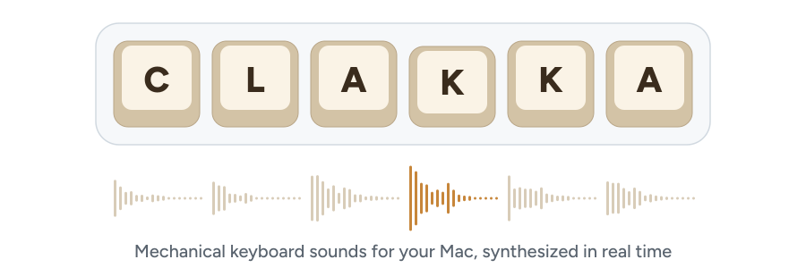

<p align="center">
  <picture>
    <source media="(prefers-color-scheme: dark)" srcset="header-dark.svg">
    
  </picture>
</p>

Clakka makes your Mac keyboard sound like a mechanical one. It doesn't play recorded samples: every key press and release is synthesized from a physical model, in the audio callback, the moment the key goes down. No two presses sound exactly the same, and each key sounds a little different from its neighbors.

It's a single Rust binary for macOS with no crate dependencies. It talks to CoreAudio and IOKit directly.

## Install

You need macOS and a Rust toolchain.

```sh
git clone git@github.com:maty-millien/Clakka.git clakka
cd clakka
cargo build --release
```

## Run

Start the engine from the repository root so it finds the `themes/` directory:

```sh
./target/release/clakka_engine
```

The first launch fails until you allow your terminal in System Settings > Privacy & Security > Input Monitoring, because Clakka reads raw keyboard input through IOHIDManager, before macOS turns the top row into media keys. Restart the engine after granting access. Stop it with Ctrl+C.

## Themes

Five themes ship in `themes/`:

| Theme  | Sound |
| ------ | ----- |
| Creamy | Soft and warm, the default |
| Thock  | Deep and heavy, lower plate and case modes |
| Clicky | Bright, with a sharp switch click |
| Marble | Smooth and cool |
| Muted  | Quiet, for late nights |

Switch themes while typing, without restarting:

- Ctrl+Option+Cmd+Left or Right cycles through them.
- Ctrl+Option+Cmd+1 to 9 jumps to a theme by position.

To start on a theme of your own, pass its file. It's loaded first, ahead of the bundled ones:

```sh
./target/release/clakka_engine --theme my-board.toml
```

## Writing a theme

A theme is a TOML file. Every value you leave out falls back to Creamy, so a theme only lists what it changes. `themes/creamy.toml` lists every parameter, and the other bundled themes show how short an override can be. This is the start of `themes/thock.toml`:

```toml
[master]
seed = 0x4B52454D54484F01

[low]
freqs = [85, 150, 110, 200]
gains_db = [-8, -7, -15, -12]

[plate]
freqs = [1037, 1073, 1154, 1312, 1381, 1493, 1534, 1566, 1610, 1663, 1793, 1913]

[noise]
hp_hz = 500
lp_hz = 4500
```

The sections map to parts of a real keyboard:

- `low`: the case and the large keys' body resonance.
- `plate`: twelve modes of the switch plate, where most of the character comes from.
- `keycap` and `switch`: the cap and the switch housing.
- `noise` and `hit`: the click transient of the impact, with an optional second bounce.
- `variation`: how much pitch, level and decay drift between presses of the same key.
- `velocity`: how typing speed changes loudness and hardness.
- `stab`: extra rattle on wide keys like space, shift and return.
- `release`: how the key-up sound differs from the key-down sound.

## How it works

Each key gets its own model, built when the theme loads: 24 resonant modes (4 low, 12 plate, 4 keycap, 4 switch) plus a filtered noise burst. The model depends on where the key sits on the board. Wider keys get lower case and keycap modes, the key's position on the plate decides which plate modes it excites, and its horizontal position sets the stereo pan and a small interaural delay, so the left Shift sounds to your left.

On a key event, the HID callback packs the key code, press or release, velocity and a random seed into one 64-bit word and pushes it onto a lock-free queue. The CoreAudio render callback pops it, starts one of 24 voices and synthesizes the sound sample by sample. Nothing on that path allocates, locks, makes a syscall or prints. The output stream asks for a 32-frame buffer, under 1 ms at 48 kHz.

To see the measured latency of every key event:

```sh
CLAKKA_LATENCY_LOG=1 ./target/release/clakka_engine
```

## Rendering to WAV

`render` runs the same synth offline and writes a stereo WAV, which helps when tuning a theme:

```sh
# 20 presses of A (key code 0), 300 ms apart
./target/release/clakka_engine render --key 0 --n 20 --gap 300 --out out/a.wav --theme themes/thock.toml

# a set of clips: letters, space, return, modifiers, a row walk and 30 s of typing at 80 WPM
./target/release/clakka_engine render --demo --dir out/thock --theme themes/thock.toml
```

Key codes are macOS virtual key codes. Run `clakka_engine --help` for every option.
